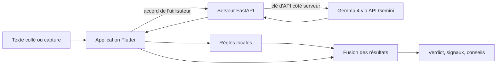

# 02 — Architecture

*État : lot 2 (analyse locale + service serveur + IA Gemma 4).*

## Vue d'ensemble



Le serveur est la **seule** partie qui connaît la clé d'API. L'application peut fonctionner sans lui.

## Application (Flutter)

```
lib/
  main.dart                    lit la configuration du serveur (--dart-define)
  app/radar_application.dart   assemble les dépendances
  core/
    configuration/             adresse et jeton du serveur
    theme/
  features/analysis/
    domain/
      models/                  verdict, signal, historique, consentement, source...
      rules/                   règles de détection et catalogue
      repositories/            contrats : consentement, historique
      services/                moteur local, moteur hybride, fusion, captures, validation...
    data/
      remote/                  client HTTP du serveur d'analyse
      local/                   consentement et historique (SharedPreferences)
      device/                  choix d'une image dans la galerie
    presentation/
      controllers/             état de l'analyse
      screens/                 accueil, résultat, historique
      widgets/                 composants réutilisables, boîte de consentement
test/                          tests unitaires, d'écran, du client HTTP, des dépôts locaux
```

## Serveur (Python, FastAPI)

```
backend/
  app/
    main.py              points d'accès HTTP : /health, /v1/analyze, /v1/analyze-image
    config.py            réglages (variables d'environnement, fichier .env)
    input_validation.py  nettoyage du texte, vérification des images
    prompts.py           instructions envoyées au modèle
    ai_provider.py       appel à Gemma 4 (modèle de secours, blocages, réponse)
    verdict_parser.py    vérification de la réponse du modèle
    analysis_service.py  limites, cache, appel au modèle, résultat
    cache.py             cache en mémoire (hachage du message, verdict)
    rate_limiter.py      limites par appareil et globale
  tests/                 tests automatiques
  Dockerfile  requirements.txt  .env.example
```

## Choix structurants

| Choix | Raison |
|---|---|
| Interface `ContentAnalyzer` + moteur hybride | Les écrans ne connaissent que ce contrat : l'IA s'ajoute sans toucher à l'interface. |
| Règles locales d'abord, IA ensuite | Rapide, gratuit, hors-ligne. L'IA complète ce que les règles ne voient pas. |
| Fusion « l'IA ne baisse jamais le risque » | Protège contre un message qui tenterait de tromper le modèle. |
| Repli automatique sur les règles locales | L'application ne tombe jamais en panne parce que l'IA l'est. |
| Serveur intermédiaire | La clé d'API ne doit jamais être dans l'application mobile. |
| Transport HTTP abstrait côté serveur | La logique (secours, blocages, réponses) se teste sans réseau ni clé. |
| Historique sans contenu | Il ne peut pas fuiter les messages reçus. |
| `ChangeNotifier`, peu de dépendances | Moins de dépendances à maintenir et à auditer. |

## Flux d'une analyse de capture d'écran

1. L'utilisateur choisit une image (réduite à 1 600 px, qualité 85).
2. L'application vérifie son format sur son contenu et sa taille, puis l'envoie au serveur (avec accord préalable).
3. Le serveur revérifie, interroge Gemma 4, valide la réponse et renvoie le verdict et le texte lu.
4. L'application applique ses règles locales au texte lu et fusionne les deux résultats.
5. Le résultat est affiché et ajouté à l'historique (sans l'image ni le texte).
