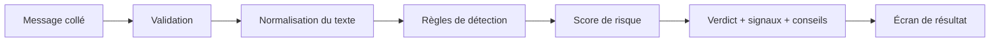

# 02 — Architecture

*État : lot 1 (analyse locale). Les parties « prévu » seront ajoutées avec l'IA.*

## Vue d'ensemble



Prévu avec l'IA : l'entrée accepte aussi captures d'écran et vocaux (convertis en texte), et un modèle de langage complète l'analyse des règles.

## Organisation du code

```
lib/
  app/                         racine de l'application
  core/theme/                  thème visuel
  features/analysis/
    domain/
      models/                  verdict, signal, niveaux, familles de menaces
      rules/                   règles de détection et catalogue
      services/                validation, normalisation, score, moteur, conseils
    presentation/
      controllers/             état de l'analyse (sans code d'affichage)
      screens/                 écran d'accueil et écran de résultat
      widgets/                 composants réutilisables
test/                          tests unitaires et tests d'écran
```

## Choix structurants

| Choix | Raison |
|---|---|
| Couches `domain` / `presentation` | La logique métier ne dépend pas de l'écran : elle est testable seule. |
| Interface `ContentAnalyzer` | Les écrans ne connaissent que ce contrat. Le moteur local peut être complété par un moteur IA sans toucher aux écrans. |
| Règles sous forme de données | Ajouter une règle ne demande de modifier qu'un seul fichier (le catalogue). |
| `ChangeNotifier` sans dépendance externe | Moins de dépendances à maintenir, moins de risques de licence et d'avertissements. |
| Contrôleur sans code d'affichage | Facilite les tests et le remplacement de l'interface. |

## Prévu pour les lots suivants

- Un **service léger côté serveur** qui garde les clés d'API hors de l'application (aucune clé dans le code mobile).
- Un `HybridContentAnalyzer` qui combine règles locales et IA derrière la même interface.
- Une couche de **persistance locale** pour l'historique, séparée de la logique métier.
